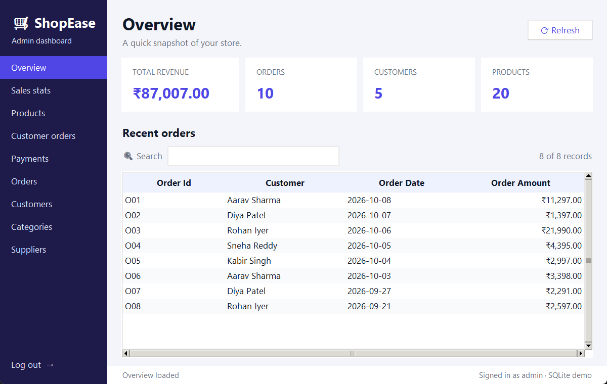
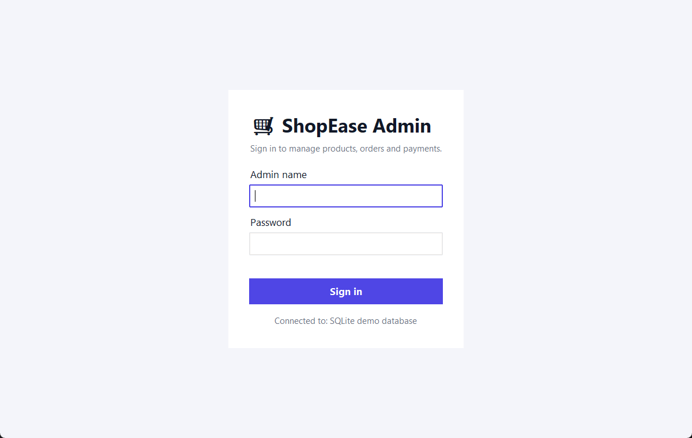
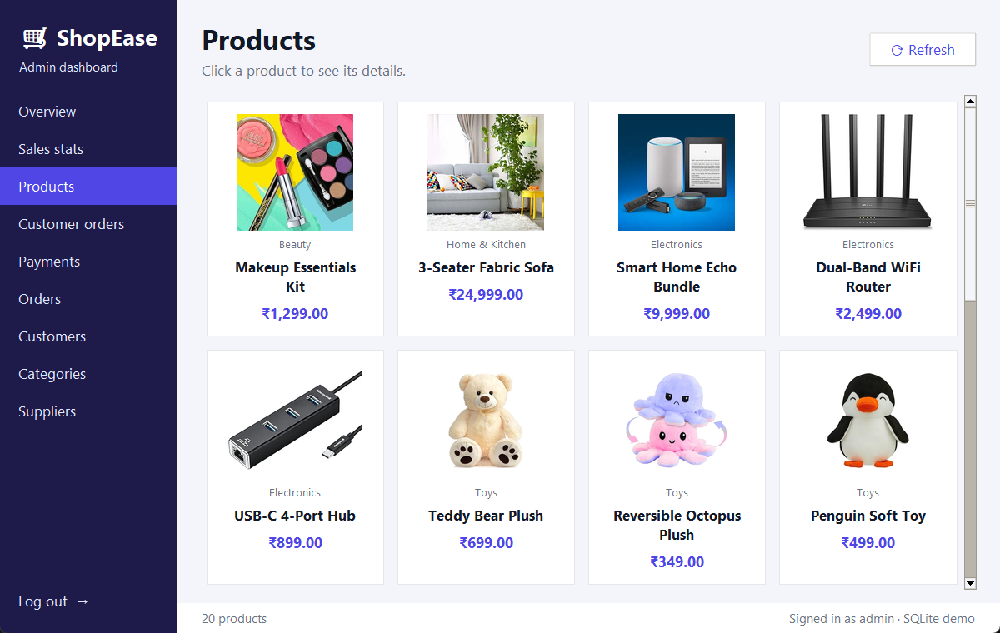
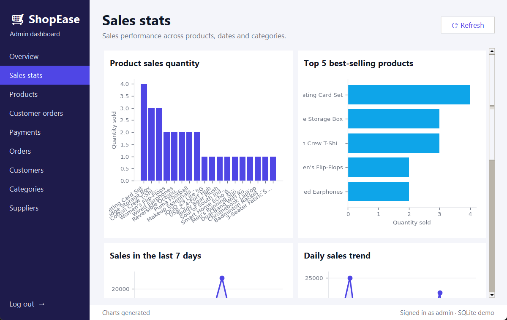

# 🛒 Online Shopping DBMS

A database-driven admin dashboard for an online store. It manages products, customers, orders,
payments and shipments on a normalised relational schema, and gives the admin a desktop
interface for browsing data and viewing sales analytics.

**Tech stack:** Python 3 · Tkinter (ttk) · Oracle 11g/XE (or SQLite for a zero-install demo) · SQL · Matplotlib · Pillow



---

## ✨ Features

- **Secure admin login.** The password comes from an environment variable, and the login locks after 5 failed attempts.
- **Overview.** KPI cards for revenue, orders, customers and products, plus the most recent orders.
- **Sales stats.** Five embedded charts: product sales, top 5 products, last 7 days, daily trend and revenue by category.
- **Product catalogue.** A responsive grid of product cards with images. Click a card to see its details.
- **Customer orders.** Line items grouped by customer.
- **Payments and raw tables** for Orders, Customers, Categories and Suppliers.
- **Every table** can be searched and sorted (click a column header), and has striped rows.
- **Two database backends.** Oracle (the original target) or a self-contained SQLite demo database.

| Login | Products | Sales stats |
|---|---|---|
|  |  |  |

---

## 🏗️ Database schema

11 tables with primary/foreign keys and integrity checks (see [db_setup.py](db_setup.py)):

| Table | Purpose |
|---|---|
| `ADMIN` | Store administrators |
| `SHOPPING_WEBSITE` | Website details, managed by an admin |
| `SUPPLIER` | Product suppliers |
| `PRODUCT_CATEGORY` | Categories belonging to a website |
| `PRODUCT` | Name, price, status, supplier, category, image |
| `CART` | Items currently in a cart |
| `CUSTOMER` | Customer contact details |
| `ORDERS` | Order header: amount, date, customer |
| `ORDER_DETAILS` | Order ↔ product line items (composite PK) |
| `PAYMENT` | Payments made against orders |
| `TRACKING_DETAILS` | Courier and tracking number per order |

Example analytics query used by the dashboard:

```sql
-- Top 5 best-selling products
SELECT P.Product_name, SUM(OD.Quantity)
FROM PRODUCT P
JOIN ORDER_DETAILS OD ON P.Product_id = OD.Product_id
GROUP BY P.Product_name
ORDER BY SUM(OD.Quantity) DESC
FETCH FIRST 5 ROWS ONLY;
```

---

## 🚀 Getting started

**Requirements:** Python 3.9+ with Tkinter (bundled with the python.org installers).

```bash
git clone https://github.com/shiva-1301/Online_Shopping_DBMS.git
cd Online_Shopping_DBMS
python -m venv .venv
.venv\Scripts\activate          # macOS/Linux: source .venv/bin/activate
pip install -r requirements.txt

copy .env.example .env          # macOS/Linux: cp .env.example .env
# edit .env and set ADMIN_PASSWORD (and Oracle credentials if you use Oracle)

python db_setup.py              # creates the tables and loads sample data
python app.py                   # launches the dashboard
```

Sign in with any admin name and the `ADMIN_PASSWORD` from your `.env`.

### Using Oracle instead of the SQLite demo

Set these in `.env`, then run `python db_setup.py` again:

```
DB_BACKEND=oracle
ORACLE_USER=...
ORACLE_PASSWORD=...
ORACLE_DSN=localhost:1521/XE
```

The app uses [`python-oracledb`](https://python-oracledb.readthedocs.io/), the maintained successor of `cx_Oracle`, which needs no Oracle Instant Client.
If `oracledb` isn't installed, the app falls back to `cx_Oracle`.

> ⚠️ `db_setup.py` **drops and recreates** all project tables.

---

## 📁 Project structure

```
├── app.py              # Tkinter admin dashboard (entry point)
├── database.py         # Config from .env, DB connection, Oracle→SQLite SQL dialect helper
├── db_setup.py         # Schema (DDL) + sample data
├── assets/images/      # Product images
├── docs/screenshots/   # README screenshots
├── requirements.txt
└── .env.example        # Template for secrets; copy to .env (git-ignored)
```

---

## 🌐 Live demo

This is a **desktop** application (Tkinter), so it can't be hosted as a website.
To try it, follow the steps above. The SQLite demo mode needs no database server.
