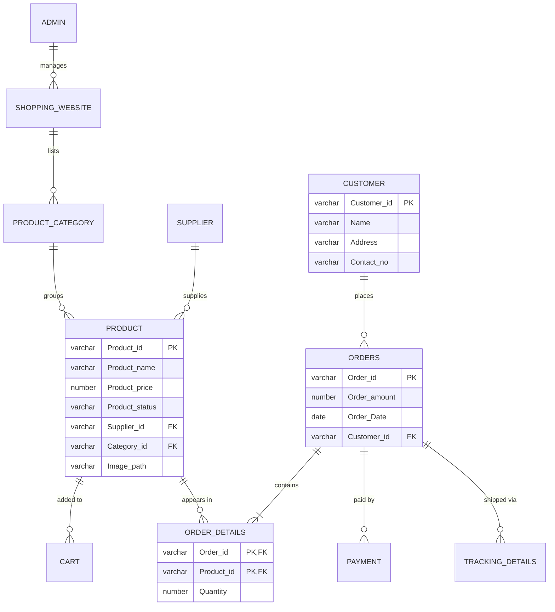
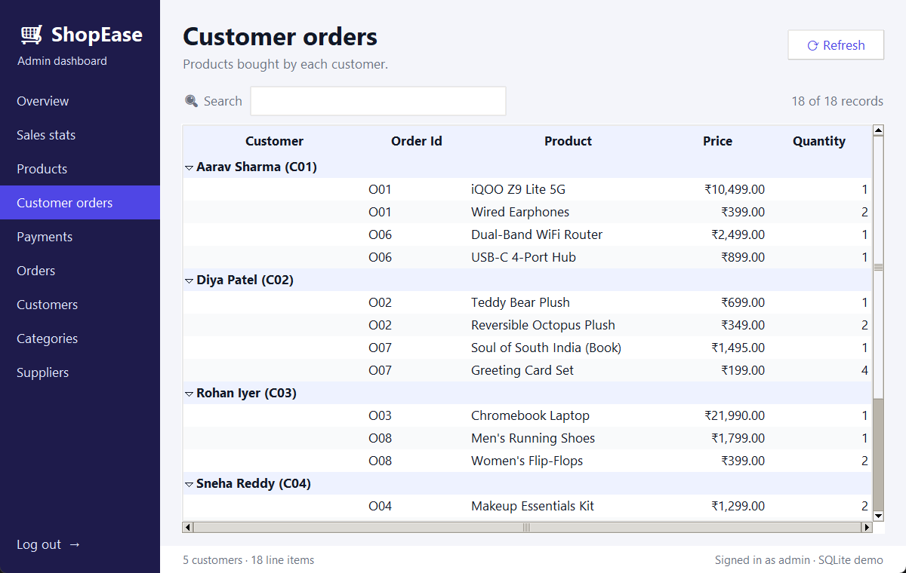

<div align="center">

# 🛒 Online Shopping DBMS

**A relational database for an online store, with a desktop admin dashboard for browsing data and sales analytics.**


[Features](#-features) · [Quick start](#-quick-start) · [Database design](#-database-design) · [Screenshots](#-screenshots) · [Configuration](#%EF%B8%8F-configuration) · [Roadmap](#-roadmap)

</div>

---

## 📖 About

Online Shopping DBMS models how an e-commerce store runs: suppliers stock products in categories,
customers place orders, and every order has line items, a payment and a shipment.

The project has two parts:

1. **A normalised 11-table schema** with primary keys, foreign keys, a composite key and integrity checks.
2. **An admin dashboard** that runs real SQL against the schema (joins, aggregations, date filters,
   top-N queries) and presents the results as searchable tables and charts.

It was first built for **Oracle** and also runs on **SQLite**, so you can try it in under a minute without installing a database server.

## ✨ Features

| | |
|---|---|
| 🔐 **Admin login** | The password is read from `.env` and never hardcoded. Login locks after 5 failed attempts. |
| 📊 **Overview** | KPI cards for revenue, orders, customers and products, plus the latest orders. |
| 📈 **Sales analytics** | Five charts: units sold per product, top 5 products, last 7 days, daily trend, revenue by category. |
| 🛍️ **Product catalogue** | A grid of image cards that reflows with the window size. Click a card for details. |
| 🧾 **Customer orders** | Every line item, grouped by customer. |
| 💳 **Payments** | Payment history, newest first. |
| 🗂️ **Table browser** | Orders, Customers, Categories and Suppliers. |
| 🔎 **Search and sort** | Every table filters as you type. Click a column header to sort. |
| 🔁 **Two backends** | Oracle for the real setup, SQLite for a zero-install demo. |

## 🚀 Quick start

> **You need:** Python 3.9+ with Tkinter. The installers from python.org include it.

```bash
# 1. Get the code
git clone https://github.com/shiva-1301/Online_Shopping_DBMS.git
cd Online_Shopping_DBMS

# 2. Install dependencies
python -m venv .venv
.venv\Scripts\activate            # macOS/Linux: source .venv/bin/activate
pip install -r requirements.txt

# 3. Configure
copy .env.example .env            # macOS/Linux: cp .env.example .env
#    then open .env and set ADMIN_PASSWORD

# 4. Create the database with sample data, then launch
python db_setup.py
python app.py
```

Sign in with **any admin name** and the `ADMIN_PASSWORD` you set.
The sample data includes 20 products, 5 customers and 10 orders, with dates relative to today so the "last 7 days" chart always has data.

## 🧩 Database design



<details>
<summary><b>All 11 tables</b></summary>

| Table | Purpose |
|---|---|
| `ADMIN` | Store administrators |
| `SHOPPING_WEBSITE` | Website details, managed by an admin |
| `SUPPLIER` | Product suppliers |
| `PRODUCT_CATEGORY` | Categories belonging to a website |
| `PRODUCT` | Name, price, status, supplier, category, image |
| `CART` | Items currently in a cart |
| `CUSTOMER` | Customer contact details |
| `ORDERS` | Order header: amount, date, customer |
| `ORDER_DETAILS` | Order ↔ product line items (composite primary key) |
| `PAYMENT` | Payments made against orders |
| `TRACKING_DETAILS` | Courier and tracking number per order |

</details>

### DBMS concepts demonstrated

- **Normalisation.** The many-to-many relationship between orders and products is resolved through `ORDER_DETAILS`.
- **Keys and constraints.** Primary keys, foreign keys, a composite key, `NOT NULL`, and `CHECK` constraints (no negative prices or quantities).
- **Multi-table joins.** For example, customer → orders → line items → products.
- **Aggregation and grouping.** `SUM`, `COUNT`, `GROUP BY` and top-N with `FETCH FIRST`.
- **Date handling.** `TO_CHAR` and `TO_DATE` for the daily and weekly sales reports.
- **Transactions.** The schema and sample data load in one transaction, and it rolls back on error.

<details>
<summary><b>Example queries from the dashboard</b></summary>

```sql
-- Top 5 best-selling products
SELECT P.Product_name, SUM(OD.Quantity)
FROM PRODUCT P
JOIN ORDER_DETAILS OD ON P.Product_id = OD.Product_id
GROUP BY P.Product_name
ORDER BY SUM(OD.Quantity) DESC
FETCH FIRST 5 ROWS ONLY;

-- Revenue by category
SELECT C.Category_name, SUM(P.Product_price * OD.Quantity)
FROM PRODUCT_CATEGORY C
JOIN PRODUCT P        ON C.Category_id = P.Category_id
JOIN ORDER_DETAILS OD ON P.Product_id  = OD.Product_id
GROUP BY C.Category_name;

-- Sales in the last 7 days
SELECT TO_CHAR(O.Order_Date, 'YYYY-MM-DD'), SUM(O.Order_amount)
FROM ORDERS O
WHERE O.Order_Date >= TO_DATE(:last_week_date, 'YYYY-MM-DD')
GROUP BY TO_CHAR(O.Order_Date, 'YYYY-MM-DD')
ORDER BY 1;
```

The same Oracle-style SQL runs on SQLite. [`database.py`](database.py) translates the few Oracle-only parts (`TO_CHAR`, `TO_DATE`, `FETCH FIRST`, `:1` bind variables) before running a query.

</details>

## 📸 Screenshots

| Login | Sales analytics |
|---|---|
|  |  |
| **Product catalogue** | **Customer orders** |
|  |  |

## ⚙️ Configuration

All settings live in `.env`. Copy `.env.example` to `.env` to start. Git ignores `.env`, so your secrets stay out of the repository.

| Variable | Default | Description |
|---|---|---|
| `DB_BACKEND` | `sqlite` | `sqlite` uses a local demo file (`shop_demo.db`). `oracle` uses the settings below. |
| `ADMIN_PASSWORD` | *(required)* | Password for the dashboard login |
| `ORACLE_USER` | — | Oracle username |
| `ORACLE_PASSWORD` | — | Oracle password |
| `ORACLE_DSN` | — | Connection string, for example `localhost:1521/XE` |

**Using Oracle:** set `DB_BACKEND=oracle` and the three `ORACLE_*` values, then run `python db_setup.py`.
The app uses [`python-oracledb`](https://python-oracledb.readthedocs.io/), the maintained successor of `cx_Oracle`, which needs no Oracle Instant Client. If `oracledb` isn't installed, the app falls back to `cx_Oracle`.

> [!WARNING]
> `db_setup.py` **drops and recreates** every project table. Don't run it against a database whose data you want to keep.

## 📁 Project structure

```
Online_Shopping_DBMS/
├── app.py              # Tkinter admin dashboard (entry point)
├── database.py         # .env config, DB connection, Oracle → SQLite SQL translation
├── db_setup.py         # Schema (DDL) + sample data
├── assets/images/      # Product images
├── docs/screenshots/   # Images used in this README
├── requirements.txt
└── .env.example        # Settings template; copy to .env
```

## 🛠️ Troubleshooting

| Problem | Fix |
|---|---|
| "ADMIN_PASSWORD is not set" on login | Create `.env` from `.env.example` and set `ADMIN_PASSWORD`. |
| `ModuleNotFoundError: No module named 'tkinter'` | On Linux run `sudo apt install python3-tk`. On Windows and macOS, use the python.org installer. |
| "no such table" or empty pages | Run `python db_setup.py` first. |
| Oracle connection fails | Check that `ORACLE_DSN` points to a running listener, for example `localhost:1521/XE`, and that the user can create tables. |

## 🗺️ Roadmap

- [ ] Add, edit and delete products, customers and orders from the dashboard
- [ ] Order status workflow (placed → paid → shipped → delivered) using `TRACKING_DETAILS`
- [ ] Customer-facing storefront with cart and checkout
- [ ] Export tables and reports to CSV
- [ ] PL/SQL triggers to keep `Order_amount` in sync with `ORDER_DETAILS`
- [ ] Packaged Windows `.exe` release

## 👤 Author

**Shiva** · [@shiva-1301](https://github.com/shiva-1301)

Built as a first-year DBMS project and later refreshed with a redesigned UI, safer configuration and an SQLite demo mode.
If you find it useful, a ⭐ is appreciated.
